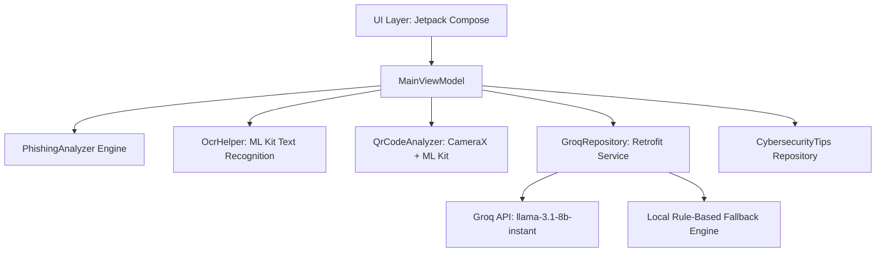

# PhishLens 🛡️📱
> **AI-Powered Mobile Phishing & Social Engineering Threat Detector**

<p align="left">
  
  
  
  
</p>

> 🏆 **Award Winner: Best Security & Privacy Hack** — Recognized for engineering an intelligent on-device defensive layer against SMS smishing, QR quishing, and spoofed alerts using ML Kit OCR and high-speed Groq AI reasoning.

Built for **Android** using **Kotlin + Jetpack Compose**, **Material 3**, **ML Kit OCR**, **CameraX Barcode Scanning**, and **Groq LLM Integration**.

---

## 🚀 Hackathon Pitch

In 2026, social engineering accounts for over 80% of digital security breaches. Attackers trick users using SMS smishing, fake email alerts, deceptive QR codes (Quishing), and disguised screenshots. Existing security tools operate silently at the network level without educating the end user.

**PhishLens** acts as an instant, intelligent security layer in your pocket. It instantly highlights suspicious triggers, analyzes URLs with offline heuristic engines, leverages Groq's high-speed LLM (`llama-3.1-8b-instant`) to provide plain-English safety breakdowns, and delivers a practical security concept after every scan—empowering users to become their own best line of defense.

---

## ✨ Features

1. **Manual Text & Link Analysis**: Paste email body, SMS text, or suspicious URLs to check for phishing triggers.
2. **Screenshot OCR Scanning**: Select any image/screenshot from the gallery to automatically extract text using Google ML Kit Text Recognition.
3. **Live QR Code Scanner**: Scan QR codes using CameraX + Google ML Kit Barcode Scanning to inspect URL destinations before opening them.
4. **Interactive Phrase Highlighting**: Visually highlights high-risk keywords and suspicious URL patterns directly within the original message.
5. **Dynamic Risk Score Meter (0–100)**: Visual circular risk gauge with automated risk categorization:
   - 🟢 **Safe** (0 – 29)
   - 🟡 **Suspicious** (30 – 65)
   - 🔴 **High Risk** (66 – 100)
6. **AI Safety Breakdown**: Leverages **Groq API** (`llama-3.1-8b-instant`) for natural-language explanations, with automatic offline fallback to local heuristic rules.
7. **Randomized Cybersecurity Lessons**: Displays bite-sized cybersecurity concepts after every scan to foster continuous security awareness.
8. **Dark Mode Support**: Sleek, modern cyber-security design system built with Jetpack Compose Material 3.

---

## 🏗️ Architecture & Project Structure

PhishLens follows modern Android **MVVM (Model-View-ViewModel)** clean architecture with `StateFlow` and unidirectional data flow.



### Folder Layout

```
app/
 ├── data/
 │    └── AnalysisResult.kt
 ├── network/
 │    ├── GroqApi.kt
 │    ├── GroqModels.kt
 │    └── GroqRepository.kt
 ├── ocr/
 │    └── OcrHelper.kt
 ├── qr/
 │    └── QrCodeAnalyzer.kt
 ├── security/
 │    ├── CybersecurityTips.kt
 │    └── PhishingAnalyzer.kt
 ├── ui/
 │    ├── components/
 │    │    ├── CameraPreview.kt
 │    │    ├── HighlightedText.kt
 │    │    └── RiskScoreBadge.kt
 │    ├── navigation/
 │    │    ├── NavGraph.kt
 │    │    └── Screen.kt
 │    ├── screens/
 │    │    ├── HomeScreen.kt
 │    │    ├── QrScannerScreen.kt
 │    │    └── ResultScreen.kt
 │    └── theme/
 │         ├── Color.kt
 │         ├── Theme.kt
 │         └── Type.kt
 ├── viewmodel/
 │    ├── MainViewModel.kt
 │    └── ScanUiState.kt
 └── MainActivity.kt
```

---

## 🛠️ Setup & Configuration

### Prerequisites
- Android Studio Hedgehog (2023.1.1) or newer
- JDK 17
- Android SDK 35 (Min SDK 24)

### 1. Adding your Groq API Key
1. Open the file `local.properties` in the root of your project directory.
2. Add your Groq API key:
```properties
GROQ_API_KEY=gsk_your_actual_groq_api_key_here
```
> *Note*: If `GROQ_API_KEY` is not set or offline, PhishLens automatically falls back to its offline rule-based explanation engine without crashing!

### 2. Building & Running
To compile and install on an Android device or emulator:

```bash
# Clean and compile debug APK
./gradlew assembleDebug

# Run unit tests
./gradlew test
```

---

## 🧪 Testing

Unit tests for `PhishingAnalyzer` verify:
- Keyword weight aggregation (`urgent`, `suspended`, `verify`, `bit.ly`, `password`, `otp`, `gift card`).
- URL heuristics: IP address detection, `@` userinfo tricks, suspicious TLDs (`.xyz`, `.top`), excessive digits.
- Score bounds normalization (capped at 100 max).
- Sample scam & sample safe verification.

Run unit tests via command line:
```bash
./gradlew testDebugUnitTest
```

---

## 📱 Sample Demo Data

- **Scam Preset**: `"Your SBI account is suspended. Verify immediately at bit.ly/sbi-verify"`
- **Safe Preset**: `"Your order #12345 has been shipped and will arrive tomorrow."`

---

## 📜 Tech Stack Summary
- **Language**: Kotlin 2.x & Coroutines
- **UI Framework**: Jetpack Compose + Material 3
- **Network**: Retrofit 2 + OkHttp 4 + Kotlinx Serialization
- **Computer Vision**: Google ML Kit Text Recognition & Barcode Scanning
- **Camera**: CameraX Lifecycle & Core 1.4
- **Architecture**: MVVM + StateFlow
